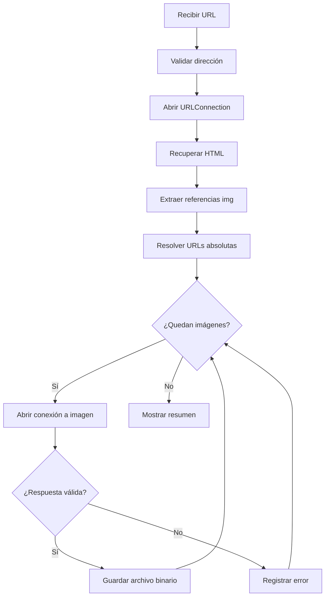

# Práctica guiada: Descarga de imágenes de una página web mediante URL y URLConnection en Java

## 1. Información general

| Elemento | Descripción |
|---|---|
| Asignatura | Desarrollo de Sistemas III |
| Unidad temática | Arquitectura cliente-servidor y programación de aplicaciones para Internet |
| Nombre de la práctica | Descargador de imágenes de páginas web |
| Duración estimada | 180 minutos |
| Modalidad | Individual |
| Entorno | IntelliJ IDEA; JDK 17 o superior; Git y GitHub |
| Restricción tecnológica | Exclusivamente clases de la API estándar de Java |
| API de comunicación | `java.net.URL`, `java.net.URLConnection` y `java.net.HttpURLConnection` |

**Restricción principal:** todas las conexiones a recursos de Internet deberán realizarse mediante `URL.openConnection()` y objetos `URLConnection` o su subclase `HttpURLConnection`. No se permite utilizar `HttpClient`, Jsoup, Apache HttpComponents ni bibliotecas externas. `URI` puede utilizarse para construir o validar direcciones y convertirlas a `URL`, pero no para establecer conexiones.

## 2. Propósito

Desarrollar una aplicación Java de línea de comandos que reciba como argumento la URL de una página web, establezca una conexión con el servidor, obtenga el documento HTML, identifique las imágenes referenciadas mediante etiquetas `` y descargue cada imagen en un archivo local.

## 3. Resultados de aprendizaje

Al finalizar, el estudiante será capaz de:

1. Explicar el funcionamiento de la arquitectura cliente-servidor en aplicaciones web.
2. Utilizar `URL` para representar la localización de recursos en Internet.
3. Establecer conexiones mediante `URLConnection`.
4. Utilizar `HttpURLConnection` para consultar códigos de respuesta HTTP.
5. Leer contenido textual y binario mediante flujos de entrada.
6. Identificar referencias a imágenes dentro de un documento HTML.
7. Resolver direcciones relativas respecto a la URL de una página.
8. Guardar recursos remotos utilizando `Files`, `Path` e `InputStream`.
9. Implementar manejo de excepciones y documentar el funcionamiento de una aplicación.

## 4. Planteamiento del problema

Una página web generalmente está compuesta por un documento HTML y múltiples recursos adicionales, como imágenes, hojas de estilo y programas JavaScript. Cuando un navegador accede a una página, solicita el documento HTML y posteriormente recupera los recursos referenciados.

Se desarrollará una aplicación denominada **ImageDownloader** que reproduzca parcialmente este comportamiento.

### Ejemplo de ejecución

```bash
java ImageDownloader https://ejemplo.org/galeria.html
```

### Resultado esperado (ilustrativo)

```text
ImageDownloader
---------------------------------------
Conectando con: https://ejemplo.org/galeria.html

Código HTTP: 200
Tipo de contenido: text/html

Analizando documento HTML...

Imágenes encontradas: 4

[1/4] logo.png ............... OK
[2/4] fotografia01.jpg ....... OK
[3/4] fotografia02.png ....... OK
[4/4] banner.webp ........... OK

---------------------------------------
Descargas exitosas: 4
Descargas fallidas: 0
Directorio: ./imagenes/
```

## 5. Arquitectura de la solución

El flujo principal es:

```text
Aplicación Java (cliente)
    |
    | URL.openConnection() / HTTP GET
    v
Servidor web ----> documento HTML
    |
    v
Análisis de etiquetas  y extracción de src
    |
    v
Resolución de direcciones relativas mediante URL
    |
    v
Nuevas conexiones URLConnection a cada imagen
    |
    v
InputStream ----> Files / Path ----> ./imagenes/
```

### Clases principales

| Clase | Funcionalidad |
|---|---|
| `URL` | Representa la localización de un recurso y permite abrir una conexión. |
| `URLConnection` | Configura la conexión y proporciona acceso a encabezados y contenido. |
| `HttpURLConnection` | Permite consultar el código de respuesta HTTP. |
| `InputStream` | Lee los bytes recibidos desde el servidor. |
| `InputStreamReader` | Convierte bytes en caracteres según una codificación. |
| `BufferedReader` | Facilita la lectura de texto. |
| `Pattern` y `Matcher` | Buscan referencias a imágenes en el HTML. |
| `Files` y `Path` | Crean directorios y almacenan imágenes. |

## 6. Desarrollo de la práctica

### Fase 1. Crear y configurar el proyecto (15 minutos)

Cree en IntelliJ IDEA el proyecto `ImageDownloader` con esta estructura:

```text
ImageDownloader/
├── .gitignore
├── README.md
├── src/
│   └── main/
│       └── java/
│           └── ImageDownloader.java
└── imagenes/
```

El directorio `imagenes/` se generará durante la ejecución y no deberá incluirse en Git.

Archivo `.gitignore`:

```gitignore
.idea/
out/
build/
*.class
imagenes/
```

Inicialice el repositorio Git y registre el primer commit.

### Fase 2. Procesar el argumento y construir una URL (15 minutos)

La aplicación deberá recibir exactamente un argumento que corresponda a la dirección de una página web.

```java
import java.net.URI;
import java.net.URL;

public class ImageDownloader {
    public static void main(String[] args) {
        if (args.length != 1) {
            System.err.println("Uso: java ImageDownloader <URL>");
            return;
        }
        try {
            URI uri = URI.create(args[0]);
            URL url = uri.toURL();
            System.out.println("Protocolo: " + url.getProtocol());
            System.out.println("Servidor: " + url.getHost());
            System.out.println("Puerto: " + url.getPort());
            System.out.println("Ruta: " + url.getPath());
        } catch (IllegalArgumentException e) {
            System.err.println("URL inválida: " + e.getMessage());
        } catch (java.net.MalformedURLException e) {
            System.err.println("URL no admitida: " + e.getMessage());
        }
    }
}
```

**Actividades:**

1. Ejecute sin argumentos.
2. Ejecute con una URL HTTPS válida.
3. Identifique protocolo, servidor y ruta.
4. Pruebe una cadena inválida.
5. Valide que solo se admitan HTTP y HTTPS y que exista un servidor válido.

**Reflexión:** ¿Cuál es la diferencia entre representar la dirección de un recurso mediante `URL` y establecer una conexión?

### Fase 3. Establecer una conexión y recuperar HTML (25 minutos)

`URL.openConnection()` crea un objeto de conexión; la comunicación efectiva se inicia al invocar `connect()` o una operación que necesita acceso al recurso, como `getInputStream()`.

```java
import java.io.BufferedReader;
import java.io.InputStream;
import java.io.InputStreamReader;
import java.net.URI;
import java.net.URL;
import java.net.URLConnection;
import java.nio.charset.StandardCharsets;

public class LeerPagina {
    public static void main(String[] args) throws Exception {
        URL url = URI.create("https://example.com/").toURL();
        URLConnection connection = url.openConnection();
        connection.setConnectTimeout(10000);
        connection.setReadTimeout(15000);
        System.out.println("Tipo de contenido: " + connection.getContentType());

        try (InputStream input = connection.getInputStream();
             BufferedReader reader = new BufferedReader(
                 new InputStreamReader(input, StandardCharsets.UTF_8))) {
            String linea;
            while ((linea = reader.readLine()) != null) {
                System.out.println(linea);
            }
        }
    }
}
```

El ejemplo presupone UTF-8. La implementación final deberá considerar la codificación indicada por el servidor.

**Actividades:**

1. Sustituya la URL fija por el argumento recibido.
2. Almacene el HTML completo en un `String`.
3. Muestre sus primeros 500 caracteres, si están disponibles.
4. Identifique el tipo de contenido.
5. Pruebe qué sucede cuando el servidor no responde.

Para HTTP/HTTPS, utilice `HttpURLConnection` para conocer el estado:

```java
import java.net.HttpURLConnection;

HttpURLConnection connection =
        (HttpURLConnection) url.openConnection();
connection.setRequestMethod("GET");
connection.setConnectTimeout(10000);
connection.setReadTimeout(15000);
int codigo = connection.getResponseCode();
System.out.println("Código HTTP: " + codigo);
```

Use `try-with-resources` para cerrar flujos y `disconnect()` en un bloque `finally` cuando corresponda.

**Preguntas:** ¿En qué se diferencian `URLConnection` y `HttpURLConnection`? ¿Por qué se establecen tiempos máximos? ¿Qué significa HTTP 404? ¿Qué sucede si la conexión funciona, pero el servidor devuelve un error?

### Fase 4. Identificar referencias a imágenes (30 minutos)

Ejemplo de HTML:

```html


```

Se utilizarán `Pattern` y `Matcher` para identificar etiquetas `` y extraer `src`:

```java
import java.util.regex.Matcher;
import java.util.regex.Pattern;

public class BuscarImagenes {
    public static void main(String[] args) {
        String html = """
            <html><body>
                
                
                
            </body></html>
            """;

        Pattern imgPattern = Pattern.compile(
            "]*>", Pattern.CASE_INSENSITIVE);
        Pattern srcPattern = Pattern.compile(
            "\\bsrc\\s*=\\s*([\"'])(.*?)\\1", Pattern.CASE_INSENSITIVE);

        Matcher imgMatcher = imgPattern.matcher(html);
        while (imgMatcher.find()) {
            String etiqueta = imgMatcher.group();
            Matcher srcMatcher = srcPattern.matcher(etiqueta);
            if (srcMatcher.find()) {
                System.out.println(srcMatcher.group(2));
            }
        }
    }
}
```

**Actividades:**

1. Identifique la función de `Pattern` y `Matcher`.
2. Explique la expresión para localizar ``.
3. Explique cómo se recupera `src`.
4. Almacene las referencias en una colección.
5. Use un `Set` para evitar referencias duplicadas.

Implemente:

```java
public static Set<String> extraerImagenes(String html) {
    // Implementar
}
```

**Limitación:** las expresiones regulares son una aproximación didáctica, no un analizador HTML completo. Documente casos no admitidos, como atributos sin comillas, marcado complejo o contenido generado por JavaScript.

### Fase 5. Resolver direcciones relativas (15 minutos)

Suponga que la página está en `https://ejemplo.org/noticias/index.html`.

| Referencia | Dirección resultante |
|---|---|
| `logo.png` | `https://ejemplo.org/noticias/logo.png` |
| `/imagenes/banner.jpg` | `https://ejemplo.org/imagenes/banner.jpg` |
| `../fotos/imagen.jpg` | `https://ejemplo.org/fotos/imagen.jpg` |

Utilice el constructor de `URL` con una URL base:

```java
import java.net.URI;
import java.net.URL;

public class ResolverURL {
    public static void main(String[] args) throws Exception {
        URL base = URI.create(
            "https://ejemplo.org/noticias/index.html").toURL();
        URL imagen = new URL(base, "../imagenes/logo.png");
        System.out.println(imagen);
    }
}
```

Implemente:

```java
public static URL resolverImagen(
        URL urlPagina, String referencia) throws Exception {
    // Implementar
}
```

El método debe resolver referencias relativas y absolutas, aceptar solo HTTP/HTTPS y rechazar referencias vacías o esquemas no admitidos (`data:`, `javascript:`).

**Reflexión:** ¿Qué ocurriría si se intentara descargar directamente `logo.png` sin considerar la URL base?

### Fase 6. Descargar y almacenar imágenes (30 minutos)

Las imágenes deben descargarse como bytes. Para cada imagen, abra una conexión independiente con `URL.openConnection()`.

```java
import java.io.IOException;
import java.io.InputStream;
import java.net.URI;
import java.net.URL;
import java.net.URLConnection;
import java.nio.file.Files;
import java.nio.file.Path;

public class DescargarImagen {
    public static void main(String[] args) throws Exception {
        URL url = URI.create(
            "https://ejemplo.org/imagenes/logo.png").toURL();
        Path directorio = Path.of("imagenes");
        Files.createDirectories(directorio);
        Path destino = directorio.resolve("logo.png");

        URLConnection connection = url.openConnection();
        connection.setConnectTimeout(10000);
        connection.setReadTimeout(15000);

        try (InputStream input = connection.getInputStream()) {
            Files.copy(input, destino);
            System.out.println("Imagen descargada: " + destino);
        } catch (IOException e) {
            System.err.println("Error al descargar: " + e.getMessage());
        }
    }
}
```

Implemente:

```java
public static boolean descargarImagen(
        URL urlImagen, Path directorio, int numero) {
    // Implementar
}
```

**Requisitos del método:**

1. Abrir la conexión mediante `URL.openConnection()`.
2. Configurar tiempos máximos.
3. Comprobar que la respuesta HTTP sea exitosa.
4. Verificar que `getContentType()` corresponda a `image/*`.
5. Leer el flujo binario.
6. Crear un nombre de archivo seguro.
7. Guardar el contenido con `Files.copy()` o un flujo de salida.
8. Cerrar recursos.
9. Registrar el resultado.

Use nombres consecutivos, como `imagen_001.png`, `imagen_002.jpg`, `imagen_003.webp`. Determine la extensión mediante tipos MIME reconocidos (`image/png`, `image/jpeg`, `image/gif`, `image/webp`), no solo mediante la URL.

No sobrescriba archivos existentes. Establezca un máximo de 10 MB por imagen y controle también los bytes efectivamente leídos, ya que `Content-Length` puede faltar o ser incorrecto. Elimine archivos parciales si ocurre un error.

**Reflexión:** ¿Por qué se utiliza `InputStream` en lugar de `BufferedReader` para las imágenes?

### Fase 7. Integración de la aplicación (20 minutos)



Organice el programa en métodos:

```java
public class ImageDownloader {
    public static void main(String[] args) {
        // Coordinar la aplicación
    }
    public static URL validarURL(String argumento) {
        // Validar URL
    }
    public static String obtenerHTML(URL url) {
        // Abrir conexión y recuperar HTML
    }
    public static Set<String> extraerImagenes(String html) {
        // Identificar referencias src
    }
    public static URL resolverImagen(URL base, String referencia) {
        // Resolver dirección
    }
    public static boolean descargarImagen(
            URL url, Path directorio, int numero) {
        // Descargar recurso binario
    }
}
```

Las firmas son orientativas; se pueden declarar excepciones o incorporar parámetros adicionales.

## 7. Pruebas funcionales

Pruebe con una página HTML sencilla en un servidor autorizado. Incluya imágenes PNG y JPEG, referencias absolutas, relativas, repetidas e inexistentes.

| Caso | Entrada o condición | Resultado esperado |
|---|---|---|
| P01 | Sin argumentos | Mostrar instrucciones de uso |
| P02 | URL inválida | Mostrar error controlado |
| P03 | Protocolo no admitido | Rechazar dirección |
| P04 | HTML sin imágenes | Reportar cero imágenes |
| P05 | URL absoluta de imagen | Descargar correctamente |
| P06 | URL relativa de imagen | Resolver y descargar |
| P07 | Imagen duplicada | Descargar una sola vez |
| P08 | Imagen inexistente | Registrar error y continuar |
| P09 | Recurso que no es imagen | Rechazar descarga |
| P10 | Servidor no disponible | Controlar excepción |
| P11 | Archivo mayor al límite | Cancelar descarga |
| P12 | Archivo existente | Evitar sobrescritura |

**Seguridad y uso responsable:** trabaje con páginas propias o autorizadas. Configure tiempos máximos y límites de descarga. Las redirecciones pueden conducir a otros destinos; para esta práctica puede restringirse el trabajo a un servidor de pruebas, deshabilitarse el seguimiento automático o validarse cada destino antes de continuar.

## 8. Preguntas de reflexión

Responda en `README.md`:

1. ¿Qué responsabilidad desempeña la aplicación dentro de una arquitectura cliente-servidor?
2. ¿Qué diferencias existen entre `URL`, `URLConnection` y `HttpURLConnection`?
3. ¿Qué sucede al invocar `openConnection()`?
4. ¿Qué operaciones provocan que la conexión se establezca realmente?
5. ¿Por qué una página HTML puede requerir múltiples conexiones?
6. ¿Cuál es la diferencia entre `getInputStream()` y `getContentType()`?
7. ¿Por qué distinguir recursos textuales y binarios?
8. ¿Para qué sirven los tiempos máximos de conexión y lectura?
9. ¿Qué limitaciones tiene analizar HTML mediante expresiones regulares?
10. ¿Cómo podría implementarse la descarga concurrente usando únicamente la API estándar de Java?

## 9. Entregables

Entregue un enlace al repositorio GitHub con:

- Código fuente completo.
- `README.md` con descripción, requisitos e instrucciones de compilación y ejecución.
- Evidencias de las pruebas funcionales.
- Respuestas a las preguntas de reflexión.
- `.gitignore` configurado.
- Historial de commits que muestre el avance.

Las imágenes descargadas deben permanecer fuera del repositorio, salvo indicación expresa del profesor y autorización para compartirlas.

## 10. Rúbrica de evaluación

| Criterio | Ponderación |
|---|---:|
| Procesamiento de argumentos y validación de URL | 10 % |
| Uso correcto de `URL` y `URLConnection` | 15 % |
| Recuperación y procesamiento del documento HTML | 15 % |
| Identificación de referencias a imágenes | 15 % |
| Resolución de URL relativas y absolutas | 10 % |
| Descarga binaria y almacenamiento | 15 % |
| Manejo de excepciones, recursos y límites | 10 % |
| Pruebas funcionales | 5 % |
| Documentación y Git/GitHub | 5 % |
| **Total** | **100 %** |

## 11. Actividad complementaria

Admita un segundo argumento opcional para especificar el directorio:

```bash
java ImageDownloader https://ejemplo.org/galeria.html ./descargas
```

Genere `descargas.csv` con las columnas URL de imagen, archivo local, estado y tamaño en bytes.

| URL de imagen | Archivo local | Estado | Tamaño (bytes) |
|---|---|---|---:|
| `https://ejemplo.org/logo.png` | `imagen_001.png` | Correcto | 15240 |
| `https://ejemplo.org/foto.jpg` | `imagen_002.jpg` | Correcto | 85420 |
| `https://ejemplo.org/otra.png` | — | Error HTTP 404 | 0 |

*Los valores son ilustrativos.*

## 12. Conclusión didáctica

La práctica demuestra que un cliente web solicita primero un documento HTML y después realiza solicitudes adicionales para recuperar sus imágenes. `URL` representa la ubicación de los recursos; `URLConnection` permite configurar y utilizar las conexiones; `HttpURLConnection` expone datos específicos de HTTP; `InputStream` recibe bytes y `Files` los almacena. Así se integran programación orientada a objetos, comunicación cliente-servidor, procesamiento de texto, archivos y excepciones sin bibliotecas externas.
